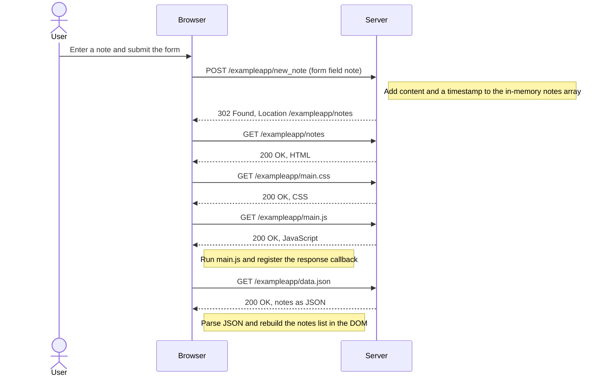
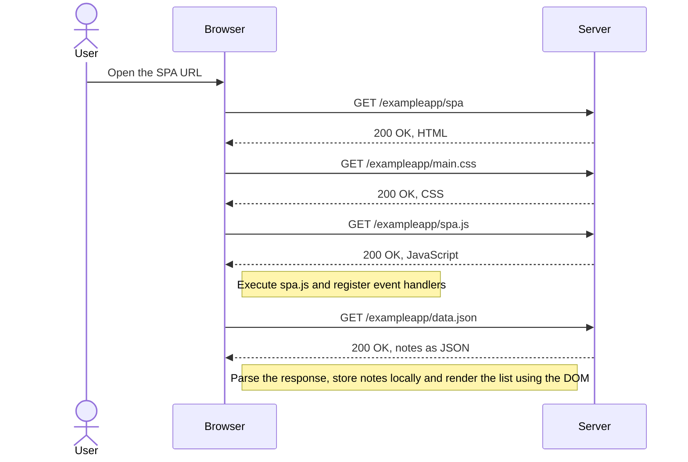
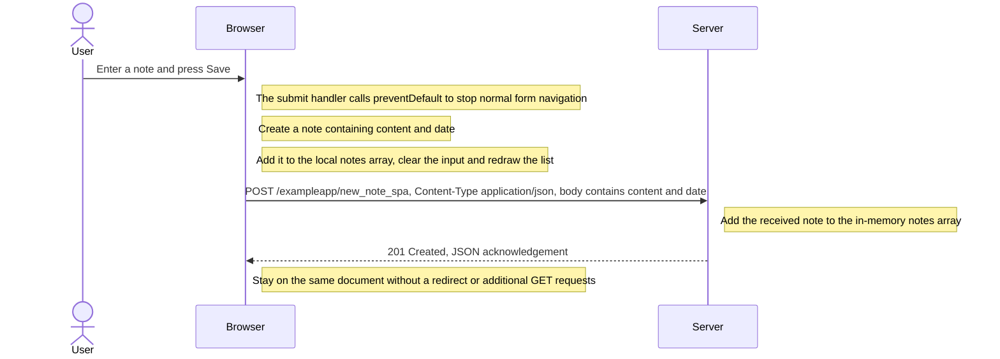

# Part 0 - Fundamentals of Web Apps

Status: diagrams 0.4-0.6 prepared; reading review pending; not submitted to the course portal.

## Checklist

- [ ] 0.1: Review the HTML tutorial.
- [ ] 0.2: Review the CSS tutorial.
- [ ] 0.3: Review the HTML forms tutorial.
- [x] 0.4: Create the traditional new-note diagram below.
- [x] 0.5: Create the SPA loading diagram below.
- [x] 0.6: Create the SPA new-note diagram below.

## Reading exercises 0.1-0.3

These exercises require reading rather than GitHub submissions. Keep them unchecked until you have reviewed the tutorials linked from the [exercise instructions](https://fullstackopen.com/en/part0/fundamentals_of_web_apps/#exercises-0-1-0-6).

- **HTML:** Elements describe structure and meaning. A heading uses h1, a paragraph uses p, and a link uses a with an href attribute. The head contains document metadata; the body contains visible content.
- **CSS:** Selectors choose elements to style. A dot selects a class, such as .notes; a hash selects an id, such as #notes. Padding adds space inside an element's border; margin adds space outside it.
- **Forms:** A label describes an input, and its for attribute matches the input's id. An input's name identifies its submitted value. The form's action chooses the destination and method chooses GET or POST. GET puts form values in the URL query; POST normally places them in the request body.

Try explaining each concept aloud and inspect the notes app with Chrome's Network and Elements panels.

## Diagrams

Read each sequence from top to bottom. Solid arrows show requests or user actions; dashed arrows show responses. Notes describe work done without a network request.

### 0.4 - Creating a note with a traditional form

Assume the notes page is already open and the user enters a note and presses Save. Paths below are relative to `https://studies.cs.helsinki.fi/exampleapp/`.

The POST sends the form data; it does not return the updated notes page. The redirect triggers a GET, after which the page fetches its assets and note data again. This produces five application requests when caching is disabled. CSS and JavaScript requests may overlap; their serial layout here simplifies the diagram. Notes are stored in memory, not a database.

[Exercise and explanation](https://fullstackopen.com/en/part0/fundamentals_of_web_apps/#forms-and-http-post)

### 0.5 - Opening the single-page notes app

This flow starts when the browser visits `https://studies.cs.helsinki.fi/exampleapp/spa`, with caching disabled.

Loading an SPA still requires an initial HTML document, stylesheet, script and data. JavaScript handles later interactions inside that document. The browser does not receive an already populated notes list in the HTML. The order shown for CSS and script downloads is illustrative; they may overlap.

[Course section](https://fullstackopen.com/en/part0/fundamentals_of_web_apps/#single-page-app)

### 0.6 - Creating a note inside the single-page app

Assume the SPA has loaded and its JavaScript has attached the form handler.

The page updates before the POST response arrives. This is a local update rather than a full page reload. The JSON POST synchronizes the new note with the server. A visible local note alone does not prove the save succeeded: the Network tab must also show a successful response.

[Course section](https://fullstackopen.com/en/part0/fundamentals_of_web_apps/#single-page-app)

## Compare the flows

| Scenario | Page navigation | Application requests with caching disabled |
| --- | --- | --- |
| Traditional new note (0.4) | Redirect and reload | POST, then HTML, CSS, JavaScript and JSON GETs |
| Open SPA (0.5) | Initial page load | HTML, CSS, JavaScript and JSON GETs |
| New note in loaded SPA (0.6) | No reload | One JSON POST |

## Review before submission

Explain why 0.4 has a redirect, why 0.5 still fetches HTML, and why 0.6 updates the list before the server acknowledges the note. Then confirm the three reading exercises are complete.

The submission portal locks a part after submission. This repository update does not submit Part 0 or claim that the reading has been completed.
